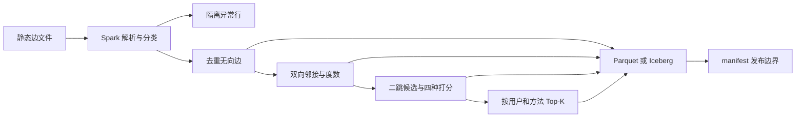

# 社交图推荐批处理管道 V3

本轮增加真实排序spill定位和分区布局对照。相同20万边、2CPU/6GiB容器、2GiB driver下，新16分区方案消除Top-K spill，但端到端从91.235秒增至151.640秒，因此仍保留baseline＋4分区＋默认AQE。可选参数用于审查内存与吞吐取舍，不宣称整体加速。

新结果见 [PERFORMANCE_V3.md](PERFORMANCE_V3.md) 和 [完整实测对照](evidence/performance/partition-accept-01/comparison.md)。V2的已有集群、Iceberg和正确性证据作为历史保留；本轮新测试以这份分区对照为准。

本项目面向大数据／数据开发实习，围绕静态社交图实现可审查的 Spark 批处理：清洗、质量检查、二跳候选、四种打分、Top-K、分层落表、失败重跑和事件日志分析。默认使用 baseline 并写 Parquet，可选择 Iceberg 快照表。现有 Facebook 数据用于正确性与回归；更大数据通过独立下载、采样和工作量预检接入。

当前实现与真实运行记录分开管理。代码、配置并不证明集群或加速已经测过；本轮实测范围与成绩见 [IMPLEMENTATION_REPORT_zh.md](IMPLEMENTATION_REPORT_zh.md)。历史文档在 [docs/legacy](docs/legacy/NOTICE.md)，原 results/ 是旧实验，不属于 V2 新成绩。

## 数据链路与输出



输入必须是每行两个非负 int64 节点 ID。注释和空行忽略，格式错误、溢出、负 ID、自环分别分类并隔离；无向边归一化后去重。打分实现 Common Neighbors、Jaccard、Adamic-Adar、Resource Allocation，不把已有好友放进候选。排序使用保留 12 位小数的 HALF_EVEN 打分降序、候选 ID 升序，原始分数保留供审查。

`baseline` 在汇总楔形路径后排除已有边；`optimized` 提前排除已有边，并增加 bridge 哈希桶的两级聚合。Spark 自己已经会部分聚合，两级聚合也没有消除高连接度节点的二跳展开开销。

当前默认采用 **baseline**。在已完成的一次 Facebook 全图、local[2]、Parquet 对照中，score 阶段 shuffle read/write 各由 26,924,883 B 增至 56,147,761 B，实验方案增加 108.53%；score 含落表由 12.376 s 变为 13.052 s，未体现收益。optimized 仅保留为显式实验对照。完整端到端耗时受 clean 阶段启动与缓存条件差异影响，不据此宣称加速。原始口径与结果见 [事件日志对照](validation/facebook-event-comparison.json)，不将该单次观测推广为所有数据集的结论。

一次成功运行发布到 `artifacts/<环境>/runs/<run-id>/`，包含：

- `manifest.json`、`_SUCCESS`：成功发布和表引用；成功 run-id 不可覆盖。
- `quality.json`：输入分类计数、重复边、节点/边数、楔形预算及结果不变量。
- `environment.json`、`timings.json`、`score_plan.txt`：运行环境、分阶段时间与执行计划。
- Parquet 模式的 `tables/`：clean_edges、quarantine、adjacency、degree、candidate_scores、recommendations。
- Iceberg 模式的 manifest 表标识与 snapshot_id；表数据位于独立 warehouse。

输出暂存于同一根目录的 `.staging/<run-id>/`。成功后本地目录原子改名；失败留下 `failure.json`，同 run-id 可重跑。Iceberg 每表独立提交，读取方必须以成功 manifest 为入口；这不是跨表事务。进程被强杀时可能留下锁，核实进程已退出后再处理对应 `.locks/<run-id>.lock`。

## 本地运行

建议 Python 3.10+、Java 17，依赖固定为 PySpark 3.5.7；Iceberg 使用 `org.apache.iceberg:iceberg-spark-runtime-3.5_2.12:1.10.0`。Windows 原生 Spark/Hadoop 文件系统可能需要匹配的本地库，Docker 路径可避开这一安装问题。脚本只临时设置当前进程环境，结束后恢复，不修改系统 PATH。

```powershell
python -m pip install -r requirements-spark.txt
.\scripts\run-local.ps1 -PythonCommand python -JavaHome 'C:\path\to\jdk17' -RunId fb-parquet-001
```

可直接调用跨平台入口：

```bash
python -m src.spark_pipeline --input data/facebook_combined.txt.gz --output artifacts/local --run-id fb-baseline-001 --master 'local[2]' --mode baseline --format parquet
# Optional experimental comparison; this mode showed no benefit in the recorded run.
python -m src.spark_pipeline --input data/facebook_combined.txt.gz --output artifacts/local --run-id fb-optimized-001 --master 'local[2]' --mode optimized --format parquet
```

Iceberg 模式首次默认通过 Maven 解析固定版本。已有对应 runtime JAR 时可显式提供，避免重复下载：

```powershell
.\scripts\run-local.ps1 -PythonCommand python -JavaHome 'C:\path\to\jdk17' -IcebergJar 'C:\path\to\iceberg-spark-runtime-3.5_2.12-1.10.0.jar' -Format iceberg -Mode baseline -RunId fb-iceberg-001
```

失败重跑演示：先用 `-FailAfter clean -RunId retry-demo` 触发未发布失败，再去掉 `-FailAfter`、保持相同 run-id 重跑。成功后第三次使用相同 run-id 应拒绝覆盖。失败重跑从头重算，未实现断点续算。

## Docker 伪分布式运行

Dockerfile 使用官方 `apache/spark:3.5.7-python3`，构建时从官方 Maven Central 下载固定的 Iceberg runtime。Compose 包含一个 master、两个 worker 和一个 submit driver，所有容器将同一项目目录挂到 `/app`；Web UI 只映射到 `127.0.0.1`。这四个容器运行在同一 Docker 主机上，不能写成四台物理机器。

本次交付包已附带校验过的 `vendor/` JAR。已有基础镜像时，可以用下面的离线构建替代 `docker compose build`，避免重复下载 JAR；两条构建路径均已实际通过。集群完整运行记录见实施报告。

```powershell
docker build --pull=false -f Dockerfile.offline -t graph-friend-recommendation-spark:3.5.7 .
docker compose up -d --no-build spark-master spark-worker-1 spark-worker-2
$env:RUN_ID = 'my-first-run'
docker compose run --rm --use-aliases --service-ports submit
docker compose down
```

```powershell
docker compose build
docker compose up -d spark-master spark-worker-1 spark-worker-2
$env:RUN_ID = 'docker-fb-001'
docker compose run --rm --use-aliases --service-ports submit
docker compose down
```

`--use-aliases` 使 worker 可以用 `submit` 访问 driver；driver 广播地址为 `submit`、绑定地址为 `0.0.0.0`。Master UI 为 http://127.0.0.1:8080，worker UI 为 8081/8082，运行中的 driver UI 为 4040。

可用环境变量切换 `TABLE_FORMAT=iceberg`、`MODE=optimized`（仅实验）、`GRAPH_INPUT=data/samples/youtube-200k.txt`、`GRAPH_OUTPUT=artifacts/docker`、`SHUFFLE_PARTITIONS=4`、`MAX_WEDGES=50000000`。GRAPH_INPUT/OUTPUT 是项目内相对路径；每个新成功结果使用新 RUN_ID。Compose 运行能力与本轮是否实测，以实施报告为准。

## 更大真实图与工作量预算

```powershell
python scripts/fetch-youtube.py
python -m src.prepare_data --input data/external/com-youtube.ungraph.txt.gz --output data/samples/youtube-200k.txt --sample-edges 200000 --seed 42
.\scripts\run-local.ps1 -InputPath data/samples/youtube-200k.txt -RunId youtube-sample-001
```

[官方 YouTube 图](https://snap.stanford.edu/data/com-Youtube.html)含 1,134,890 个节点和 2,987,624 条无向边。下载器保存原始压缩文件 SHA-256、来源和 HTTP 元数据并验证 gzip CRC；SHA 是下载字节的标识，不是官方签名。采样器使用固定种子的有效边记录蓄水池采样，去重后输出实际边数、节点数、最大度数和二跳楔形量；样本不冒充全量图。

精确二跳连接开销与 `sum d(v)*(d(v)-1)/2` 相关。管道在连接前检查默认 5,000 万楔形预算，超限拒绝启动自连接。只有看过预检结果和资源后才显式提高 `--max-wedges`；下载了全图不等于完成全图计算。图没有真实时间戳，不生成假时间来声称未来推荐效果。

## 真实 Spark 日志与性能对照

每次运行保留未压缩 Spark JSON eventlog。选定一次应用的日志文件，再运行：

```powershell
python -m src.eventlog_metrics --input artifacts/local/event-logs/<应用日志文件> --output artifacts/local/metrics-fb-baseline-001.json
```

解析器也支持 gzip 和 `events_*` rolling 目录。`summary.all_attempts` 计入成功、失败、被取消、重试和推测执行的实际资源量；`logical_successful_tasks` 对成功 stage 的每个分区选择一次成功结果。job 会共享 stage，因此 job 总量不可直接相加。输出 shuffle 读写字节、spill、CPU ns、运行/GC ms、成功 task 时长 p50/p95，并分别列出 job/stage/task 成败。shuffle read 含远端与本地读取，不等于纯网络流量。

比较 baseline/optimized 时应固定数据、版本、资源、分区数和输出格式，交替运行多个独立 run-id，记录冷/热缓存条件，比较中位数及波动；不能拿单次样本宣称稳定加速。业务效果使用独立隐藏边评估，不能从执行时间推断推荐质量。

## 测试与旧版实验

```powershell
python -m pytest tests/test_experiment.py tests/test_eventlog_metrics.py -q
python -m pytest tests/test_spark_pipeline.py -q
```

前一组已有 38 项指标与日志单元测试；Spark 验证的实际执行状态及完整检查清单见 [VALIDATION.md](VALIDATION.md)和实施报告。当前源代码修正了旧 AP 的并列偏差；V2 实验使用新目录，不覆盖历史 results：

```powershell
python -m src.experiment --data data/facebook_combined.txt.gz --output artifacts/reference-v2 --source-name 'Stanford SNAP ego-Facebook combined graph' --source-url https://snap.stanford.edu/data/ego-Facebook.html
python -m src.summarize --results artifacts/reference-v2
```

旧 AP、AUC、Top-K 和模拟记录量都保持其原实验身份。参考算法是小图评估器；大图分布式实现使用 spark_pipeline。项目尚不包含线上推荐 A/B、真实时间外推、增量删边或跨表事务。
